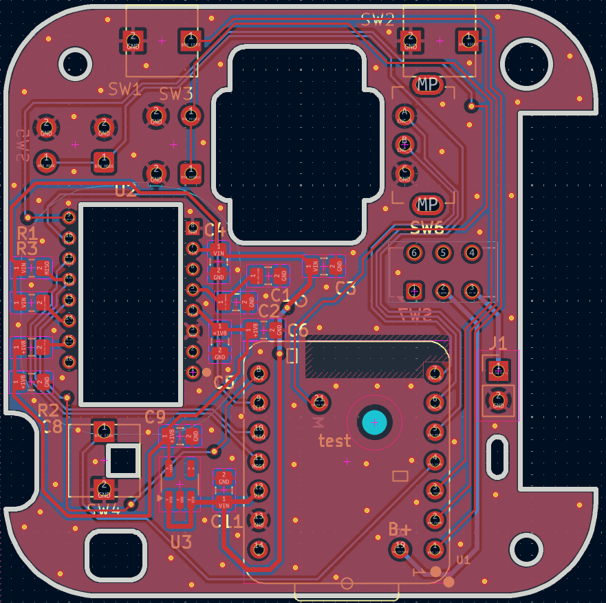
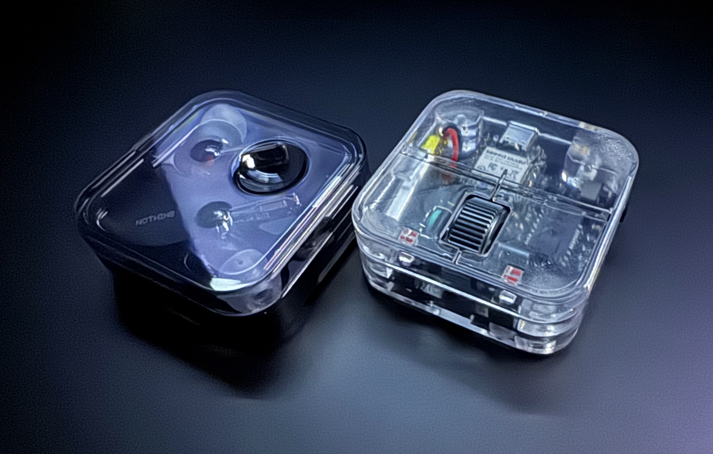
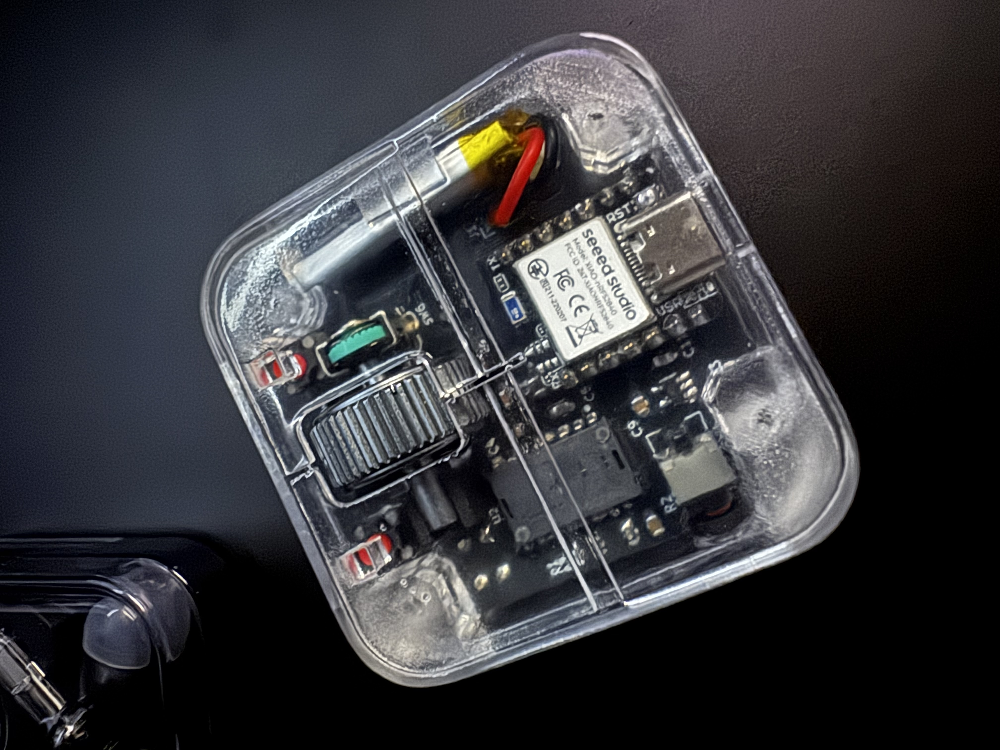
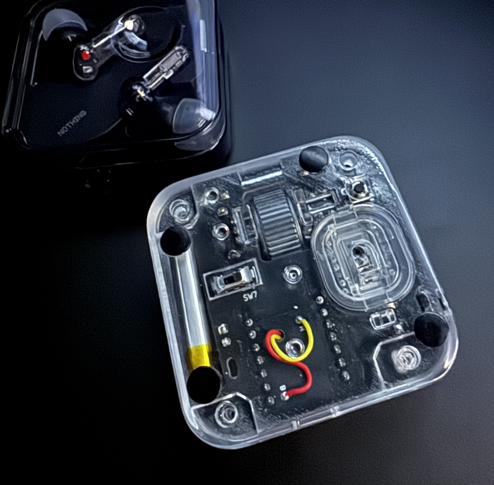
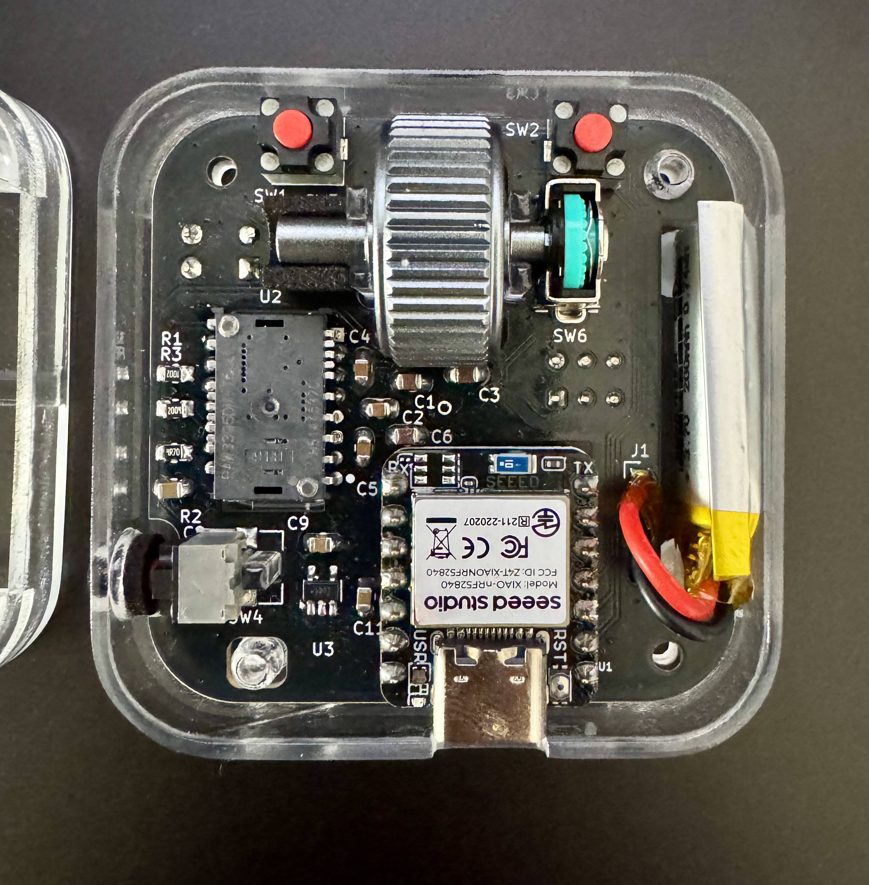
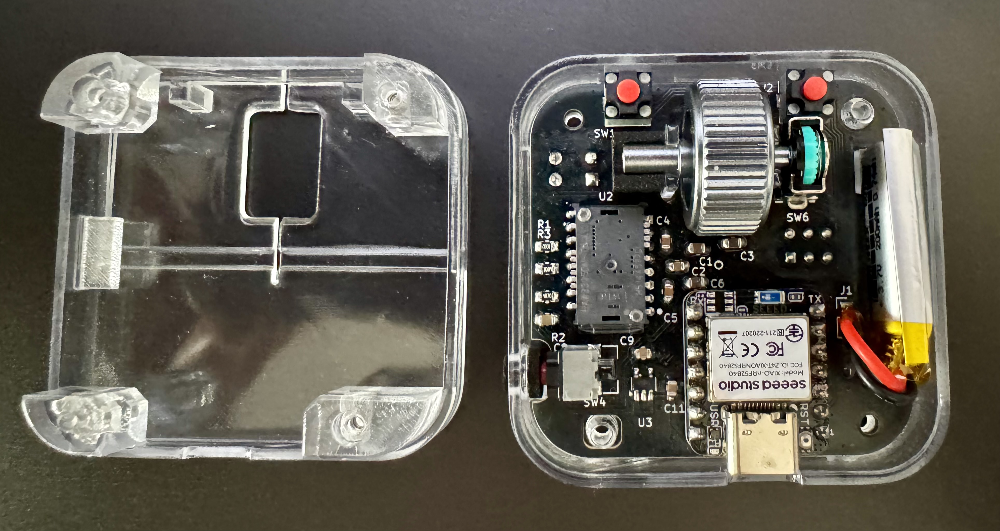
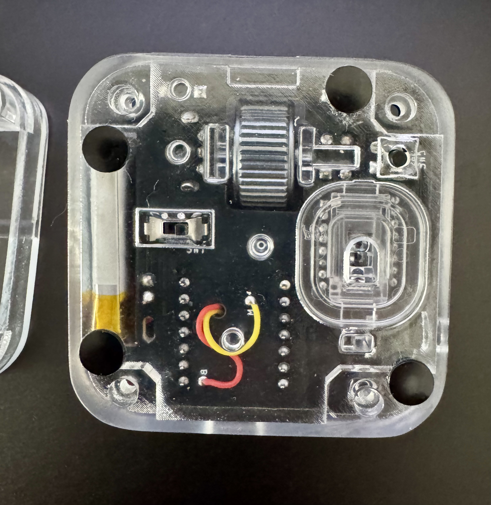
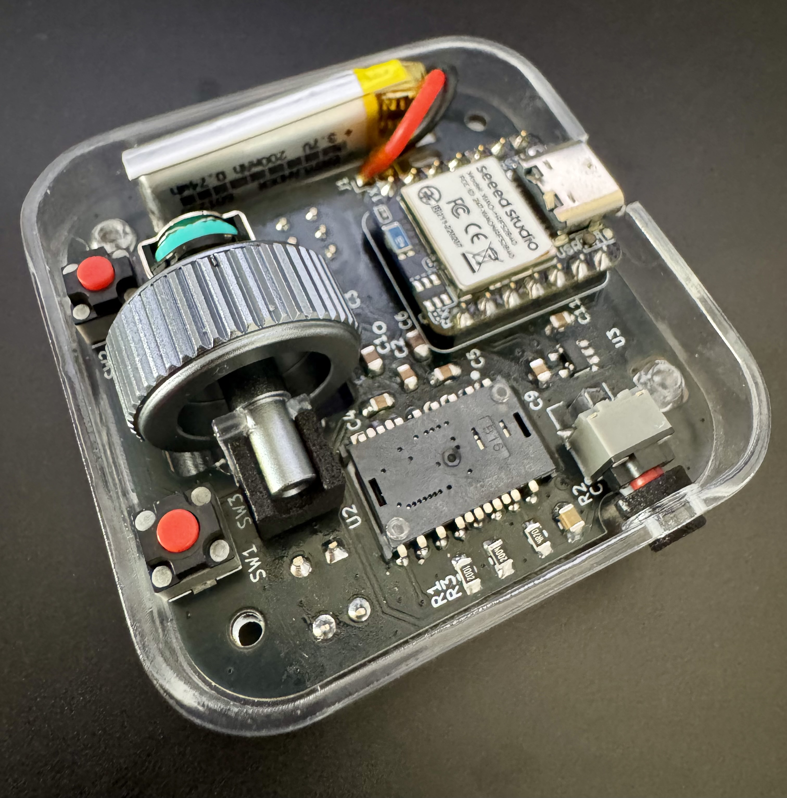
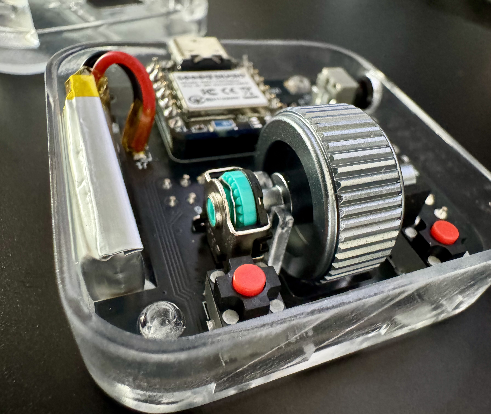

# Hardware & Reference Materials

Schematic diagram, PCB overview, and assembly reference photos for Project N-Mouse.

---

## 📐 Design & Layout

### Schematic
- PDF format: [`n-mouse_schematic.pdf`](n-mouse_schematic.pdf)

### PCB Layout

---

## 📸 Assembly & Reference Photos

---

## ⚠️ Notes & Disclaimer
These materials are provided strictly for educational and personal DIY reference. Raw manufacturing files (Gerber) and PCB source projects are not distributed.
